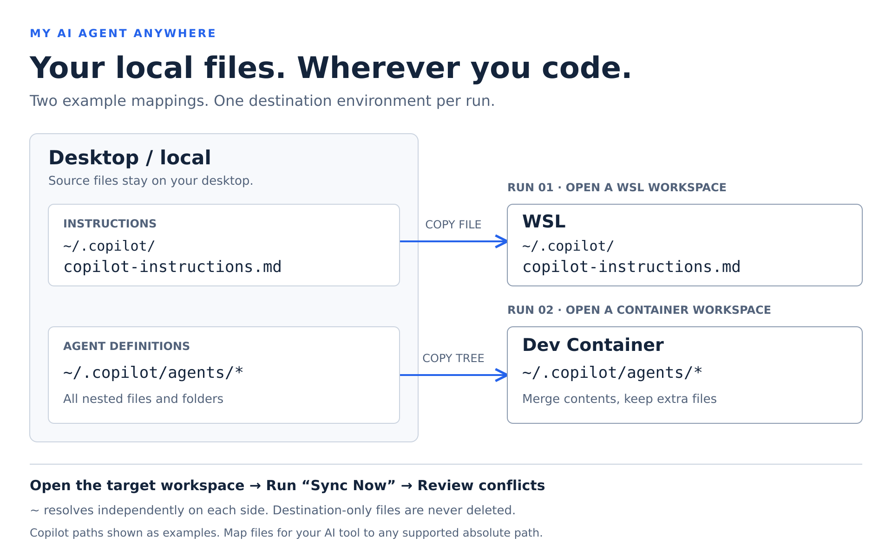

# My AI Agent Anywhere

English | [日本語](./docs/ja/README.md)

Sync your local AI configuration files to WSL and Dev Containers.



Example paths for Copilot; use mappings for your AI tool. Each arrow is a separate
**Sync Now** run in the corresponding editor environment, not simultaneous delivery.
`agents/*` illustrates directory contents; configure `agents` as a directory path,
not a wildcard.

Manually copy personal AI instructions, agent definitions, skills and other files from desktop
VS Code to the current **local, WSL or Dev Container** environment. Keep desktop
files as the source of truth, without per-project bind mounts.

Configure once, then run **My AI Agent Anywhere: Sync Now** in the editor window you want
to use. Destination edits are protected by file-level conflict detection, and
destination-only files are never deleted.

This is not an official GitHub or Microsoft product. Documentation is available
in English and Japanese; commands and messages currently use English.

## Who is this for?

For developers who keep personal instructions, agents or skills on their desktop
and want selected files available in the environment they are currently editing,
without adding personal files or mount configuration to every project.

- Use existing desktop files, including files outside `.copilot`, without
  uploading them to a shared repository.
- Configure exact destinations once and optionally filter by environment.
- Merge directories without deleting destination-only content, and review
  destination edits instead of blindly overwriting them.

You may not need this extension if VS Code already makes all your customizations
available in your workflow, or your existing mounts/dotfiles setup works well.
It does not replace Settings Sync, manage AI service accounts, or run AI agents.
Choose destinations that your AI tool recognizes; copying files does not
guarantee that a tool discovers or uses them.

## Install from Marketplace

1. In desktop VS Code, open **Extensions** (`Ctrl+Shift+X`).
2. Search for **My AI Agent Anywhere**, open its listing and select **Install**.
3. If you use WSL or Dev Containers, keep My AI Agent Anywhere installed on the
   **desktop/local side**: it reads the desktop files and writes through the
   current editor connection.

Use desktop VS Code 1.100 or later and a trusted folder. For remote environments,
connect using the WSL or Dev Containers extension.

### First sync

1. Run **My AI Agent Anywhere: Open Sync Configuration**.
2. Edit the mappings below and **save** the JSON.
3. Open the intended local, WSL or Dev Container folder.
4. Run **My AI Agent Anywhere: Sync Now**. For remote `~/` paths, approve the home-resolution
   task, or cancel and configure absolute destination paths instead.
5. Check the detected environment, resolved home and comparison counts in the
   confirmation. Review **My AI Agent Anywhere** Output for exact source/destination paths.
6. Confirm the batch and resolve or skip individual conflicts.
7. Start a new session in your AI tool and check configuration discovery and usage.
   Verified copying does **not** prove that the tool loads or applies instructions.

Standalone Agents window sessions, SSH and unknown remote types are unsupported.
They are not silently treated as local workspaces.

## Use across multiple projects

**One personal configuration can serve multiple projects.** Open a project in
local VS Code, WSL or a Dev Container and run **My AI Agent Anywhere: Sync Now**.
Sources always refer to the desktop; destinations refer to that editor window's
environment. You do not need to register each project or add a configuration
file to its repository.

| Where you open the project | What happens                                                                      |
| -------------------------- | --------------------------------------------------------------------------------- |
| Local                      | Copy to local destinations. Identical source/destination paths are skipped.       |
| WSL                        | Copy to that WSL environment; destination `~/` uses its execution user's home.    |
| Dev Container              | Copy into the current container; destination `~/` uses its execution user's home. |

Two projects using the **same WSL home and destination file** share the same
file and synchronization history. Different containers/connections or destination
paths have separate histories. Environment filters let you choose which mappings
apply; a run copies only to the current environment, not to all projects at once.
Configuration is personal, not selected per project.

Recreating a container may change its connection identity. If previous history
is unavailable, an existing unequal destination is treated as a conflict rather
than overwritten automatically. Opening a project does not trigger synchronization;
run the command when needed.

## Configuration

Personal `sync.json` lives in desktop extension storage, outside projects.
The configuration command creates an example with only the first mapping below.
The example below uses GitHub Copilot paths, but the extension is not limited
to Copilot. Set sources and destinations for your AI tool and add existing
agent/skill directories as needed:

```json
{
  "version": 1,
  "mappings": [
    {
      "source": "~/.copilot/copilot-instructions.md",
      "destination": {
        "path": "~/.copilot/copilot-instructions.md"
      }
    },
    {
      "source": "~/.copilot/agents",
      "destination": {
        "path": "~/.copilot/agents"
      }
    },
    {
      "source": "~/my-container-skills",
      "destination": {
        "path": "~/.copilot/skills",
        "environments": ["devcontainer"]
      }
    }
  ]
}
```

| Field                      | Meaning                                                                         |
| -------------------------- | ------------------------------------------------------------------------------- |
| `version`                  | Required; currently `1`.                                                        |
| `mappings`                 | Non-empty array of file/directory mappings.                                     |
| `source`                   | Desktop filesystem path, regardless of the open environment.                    |
| `destination.path`         | Exact destination path in the current editor environment.                       |
| `destination.environments` | Optional non-empty array of `local`, `wsl`, `devcontainer`. Omit for all three. |

Filters select mappings; they do not establish connections or copy to several
environments in one run. Excluded sources are not scanned. Different destinations
per environment can use separate, non-overlapping filtered mappings.
Unknown fields/values and duplicate filters are errors.

### Paths and home directories

- Source `~/` means the **desktop user's home** (for example `C:/Users/me`).
- Destination `~/` means the **current environment's execution user home**.
  Local workspaces use the desktop home.
- Remote homes are not guessed. With approval, a fixed `/bin/sh` task scoped
  to the remote workspace reads `$HOME` into a uniquely named private directory
  in remote `/tmp`, reads it back via VS Code and removes that directory.
  No configured path or file content is executed as a command.
- This requires remote task execution, `/bin/sh`, `mkdir` and writable `/tmp`.
  The task environment's `HOME` is used; custom task environment overrides can
  affect it. Verify the displayed result. It does not inspect your AI tool's process.
  If the probe fails, syncing stops. Explicit absolute destinations need no probe.
- Absolute desktop paths (including Windows drives/UNC) and absolute
  destination paths in the target OS's syntax are supported. Prefer `~/` and `/`
  separators; JSON backslashes require escaping.
- `~user`, `~\`, environment-variable interpolation, relative paths and `..`
  traversal are unsupported. No `.copilot` or source basename is appended.

### Files and directory merging

A file mapping names the exact target file, so renaming is possible.
Directory mappings recursively merge their **contents**, file by file.
For example, `~/skills` → `~/.copilot/skills` places `review/SKILL.md` at
`~/.copilot/skills/review/SKILL.md`, not `skills/skills/review/SKILL.md`.

Missing directories and parents are created, including empty source directories.
Directories are never replaced as a whole. **Destination-only files and
directories are never deleted**, even after their source counterpart is removed.
File/directory type mismatches stop the batch during preflight without deleting
the blocking path.

In local workspaces, identical resolved source/destination paths (and files
with the same inode, such as hardlinks) are skipped. Recursive self-copy,
cross-mapping source/destination overlap and overlapping destination roots
are rejected. Other local hardlinked destination files are rejected to protect
their aliases. Symlinks in selected source or destination paths are unsupported.

Never select the entire home or all `.copilot` contents: they may contain
credentials and conversations. Avoid duplicating agents/skills already
forwarded by VS Code.

## Conflicts and overwrite safety

Each file compares source, destination and the last common SHA-256 baseline.
Baselines are isolated by environment, resolved source path and destination URI
(including remote authority).

| State                                                 | Behavior                                   |
| ----------------------------------------------------- | ------------------------------------------ |
| Same bytes on both sides                              | Skip writing and record a common baseline. |
| No destination and no baseline                        | Create.                                    |
| Only source changed                                   | Update after batch confirmation.           |
| Destination changed or was deleted since the baseline | Conflict.                                  |
| Existing unequal destination without a baseline       | Conflict.                                  |

**Show diff** compares read-only snapshots, desktop left and destination right.
**Skip this file** preserves the destination and leaves the conflict unresolved.
**Force overwrite with desktop version** requires another confirmation and uses
the reviewed source snapshot, not subsequent edits. **Stop sync** does not undo
previously copied files or created directories. To resolve manually, incorporate
desired changes into the desktop source; identical bytes establish a baseline
on the next sync.

**No backups are created, and the extension cannot restore overwritten content.**
Batch and force-overwrite confirmations explicitly warn about this.
Create your own copy beforehand if the destination must be recoverable.
Files are rechecked before writes and read back for byte verification.
A failed write/verification does not record success, but does not restore the
previous content either.

## Limits and troubleshooting

- **Commands missing:** install on desktop VS Code and reload.
- **Unsupported environment:** open a supported folder in the editor, not just
  an Agents window session.
- **Home probe fails:** check remote tasks, `/bin/sh`, `/tmp` permissions, or
  use explicit absolute destinations. Cleanup failures are reported in Output.
- **Permission denied:** check source/destination user and permissions.
  The extension does not use `sudo` or change ownership.
- **Type mismatch/symlink:** choose regular files/directories and remove the
  ambiguity manually; the extension will not delete the blocking object.
- Limits per run: **5 MiB/file, 1,000 files, 50 MiB total source content,
  10,000 scanned entries** (including directories), across selected mappings.
  Reviewed destination snapshots also have a separate **50 MiB** total limit.
- Script executable modes are not copied. Runtime, line endings and execution
  permissions may need separate setup. Diffs are intended for text.
- No atomic compare-and-swap is available in the VS Code filesystem API.
  Avoid concurrent destination edits or filesystem changes during sync.
- There is no batch-wide transaction, rollback, automatic deletion or watcher.

## Next milestone

**Planned, not implemented:** opt-in automatic synchronization when an editor
workspace opens, for local, WSL and Dev Container environments.

- Copy new files and source-only changes without a per-run confirmation.
  Leave unchanged files alone; never automatically overwrite conflicts.
- Notify about conflicts and direct users to manual **Sync Now** review.
- Wait until the destination filesystem is accessible, with bounded retries
  for connection readiness. Permission and configuration errors stop the run.
- Obtain explicit consent when enabling automation, including remote home
  resolution tasks and overwrites without backups.
- Keep successful runs quiet, with results available in **My AI Agent Anywhere** Output.

Destination accessibility does not guarantee that every Dev Container lifecycle
command has finished. Timing alongside container initialization needs validation.
Synchronization also cannot guarantee that an already-started AI session
reloads configuration. Start a new session after synchronization completes.
This is a roadmap direction, not a release-date commitment.

## Privacy

My AI Agent Anywhere reads selected desktop files, writes to the current environment and
stores configuration and hashes on the desktop. It sends no files to
an additional cloud service and adds no telemetry. Remote transfers use VS Code's
existing connection, which may involve network traffic. It does not change
your AI tools' own data handling.

## Additional information

### Configuration and history storage

Use **My AI Agent Anywhere: Open Sync Configuration** to edit your settings; you do not
need to find the storage directory manually.

The configuration is `sync.json` in VS Code's desktop extension storage
(`globalStorageUri`). Baseline hashes are stored in VS Code's `globalState`,
keyed by environment, absolute source path and complete destination URI.
The extension does not create synchronization metadata in project folders or
save backup copies. Configuration and history are not automatically shared
between desktop installations.

### Optional: install from a VSIX

If you have a VSIX file, run **Extensions: Install from VSIX...** in desktop
VS Code, select it and reload if requested. Double-clicking the file is not the
installation method.

### Languages and development

Use the language link at the top for the Japanese guide; VS Code does not
automatically choose the README language. For source builds and contribution
details, see the [development guide](./src/README.md).
