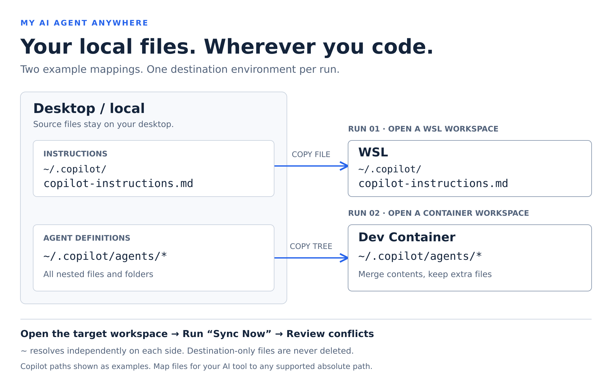

# My AI Agent Anywhere

[English](../../README.md) | 日本語

いつものAI設定を、どの開発環境でも。

ローカルのAI設定ファイルを、WSL・DevContainerへ同期。



図はCopilot向けのパスの例です。使うAIツールに合わせて対応付けを変更できます。
矢印ごとに対象のエディター環境で **Sync Now** を実行し、同時配信は行いません。
`agents/*`は中身を示す表記です。実際の設定にはワイルドカードではなく、
フォルダーパスの`agents`を指定してください。

デスクトップ側の個人用AI指示・エージェント定義・スキルなどのファイルを、現在開いている
**ローカル・WSL・DevContainer**へ手動コピーします。
プロジェクトごとのマウント設定なしで、デスクトップ側を正本として管理できます。

一度設定すれば、使いたいエディターで **My AI Agent Anywhere: Sync Now** を実行するだけです。
コピー先の変更はファイル単位の競合検知で保護し、コピー先だけのファイルは削除しません。

GitHub・Microsoftの公式製品ではありません。資料は日英対応、拡張UIは英語です。

## どんな人向け？

個人用の指示・Agents・Skillsをデスクトップで管理し、現在開いている環境へ
必要なものだけ持ち込みたい人向けです。
プロジェクトごとに個人ファイルやマウント設定を追加せずに使えます。

- `.copilot`以外も含む手元のファイルを、共有リポジトリへ公開せずに利用。
- 正確なコピー先を一度設定し、必要なら環境で絞り込み。
- コピー先だけの内容を消さずにマージし、コピー先の変更は競合として確認。

VS Codeの既存機能ですべてのカスタマイズが利用できる場合や、
マウント・dotfilesの仕組みで困っていなければ、この拡張は不要かもしれません。
Settings Syncの代替やAIサービスのアカウント管理、エージェントの実行機能ではありません。
コピー先は使うAIツールが認識する場所に設定してください。
コピーだけでは、ツールによる検出・適用は保証しません。

## Marketplaceからインストール

1. デスクトップ版VS Codeの **拡張機能**（`Ctrl+Shift+X`）を開く。
2. **My AI Agent Anywhere** を検索し、掲載ページから **インストール** を選択。
3. WSL・DevContainerで使う場合も、My AI Agent Anywhereは**デスクトップ／ローカル側**へ
   インストールします。手元のファイルを読み、現在のエディターの接続先へ書き込みます。

デスクトップ版VS Code 1.100以降で、信頼済みフォルダーを開いてください。
リモート環境には、WSLまたはDev Containers拡張で接続します。

### 最初の同期

1. **My AI Agent Anywhere: Open Sync Configuration** を実行。
2. 下記の対応付けを編集し、JSONを**保存**。
3. コピー先となるローカル・WSL・DevContainerのフォルダーをエディターで開く。
4. **My AI Agent Anywhere: Sync Now** を実行。リモートの`~/`を使う場合はホーム取得用
   タスクを許可するか、キャンセルして絶対パスに変更。
5. 環境・解決されたホーム・比較件数を確認。
   正確なコピー元・先のパスは「出力」の **My AI Agent Anywhere** に表示されます。
6. 一括確認後、各ファイルの競合を解決またはスキップ。
7. AIツールの新しいセッションで、設定の検出・適用を確認。
   コピーとバイト一致の検証だけでは、ツールによる読み込みは保証されません。

独立したAgentsウィンドウのセッション、SSH、不明なリモート環境には未対応です。
不明な環境をローカルとみなして書き込むことはありません。

## 複数プロジェクトで使う

**一つの個人設定を、複数のプロジェクトで使えます。**
ローカル・WSL・DevContainerでプロジェクトを開き、
**My AI Agent Anywhere: Sync Now** を実行してください。
コピー元は常にデスクトップ側、コピー先はそのエディターが開いている環境です。
プロジェクトごとの登録や、リポジトリへの設定ファイル追加は不要です。

| プロジェクトを開く環境 | 動作                                                         |
| ---------------------- | ------------------------------------------------------------ |
| ローカル               | ローカルのコピー先へ転送。同じコピー元・先ならスキップ。     |
| WSL                    | そのWSL環境へ転送。コピー先の`~/`は実行ユーザーのホーム。    |
| DevContainer           | 現在のコンテナへ転送。コピー先の`~/`は実行ユーザーのホーム。 |

**同じWSLホームの同じファイル**を使うプロジェクト同士では、実体も同期履歴も共有します。
別コンテナ・別接続・別コピー先なら履歴を分離します。
環境フィルターで対応付けを絞り込めますが、1回の操作で転送するのは現在の環境だけです。
全プロジェクトへの一括転送や、プロジェクトごとの設定切り替えは行いません。

コンテナ再作成で接続識別子が変わる場合があります。過去の履歴を参照できなければ、
既存の異なるコピー先は自動上書きせず競合として扱います。
プロジェクトを開くだけでは同期しません。必要なときにコマンドを実行してください。

## 設定

個人用`sync.json`はデスクトップ側の拡張ストレージに置き、プロジェクトには
含めません。設定コマンドは下記の最初の対応付けだけを持つ初期例を作ります。
下の例はGitHub Copilot向けのパスですが、Copilot専用ではありません。
使うAIツールに合わせてコピー元・先を設定し、存在するエージェント・スキルなどを
必要に応じて追加してください。

```json
{
  "version": 1,
  "mappings": [
    {
      "source": "~/.copilot/copilot-instructions.md",
      "destination": {
        "path": "~/.copilot/copilot-instructions.md"
      }
    },
    {
      "source": "~/.copilot/agents",
      "destination": {
        "path": "~/.copilot/agents"
      }
    },
    {
      "source": "~/my-container-skills",
      "destination": {
        "path": "~/.copilot/skills",
        "environments": ["devcontainer"]
      }
    }
  ]
}
```

| 項目                       | 意味                                                                   |
| -------------------------- | ---------------------------------------------------------------------- |
| `version`                  | 必須。現在は`1`。                                                      |
| `mappings`                 | ファイル・フォルダーの対応付け。空配列は不可。                         |
| `source`                   | 開いている環境によらず、デスクトップ側のパス。                         |
| `destination.path`         | 現在のエディター環境内の、正確なコピー先。                             |
| `destination.environments` | 任意。`local`・`wsl`・`devcontainer`の空でない配列。省略すると全環境。 |

環境指定は対象の絞り込みであり、接続を開いたり、1回で複数環境へ転送する機能では
ありません。対象外のコピー元はスキャンしません。環境ごとに異なるコピー先が
必要なら、環境指定付きの対応付けを分けられます。
同時に有効なコピー先の重複、不明な項目・値、環境指定の重複はエラーです。

### パスとホーム

- コピー元の`~/`は**デスクトップユーザーのホーム**です。
  Windowsなら、例えば`C:/Users/me`です。
- コピー先の`~/`は**現在の環境の実行ユーザーホーム**です。
  ローカルならデスクトップ側のホームです。
- リモートホームは推測しません。許可後、リモートのワークスペースに属する固定の
  `/bin/sh`タスクで、`$HOME`だけをリモート`/tmp`内の一意な非公開ディレクトリへ
  書き出し、VS Code経由で読み、ディレクトリを削除します。
  設定のパスやファイル内容をコマンドとして実行することはありません。
- リモートタスク実行、`/bin/sh`、`mkdir`、書き込み可能な`/tmp`が必要です。
  タスク実行環境の`HOME`を使うため、タスク環境のカスタマイズの影響を受けます。
  表示結果を確認してください。AIツールのプロセスのホームを直接調べる機能ではありません。
  取得失敗時は停止します。絶対パスのコピー先なら取得タスクは不要です。
- コピー元ではWindowsドライブ・UNCを含む絶対パス、コピー先では対象OS形式の
  絶対パスも使えます。基本は`~/`と`/`区切りがおすすめです。
  JSONのバックスラッシュはエスケープが必要です。
- `~user`、`~\`、環境変数展開、相対パス、`..`は非対応です。
  `.copilot`や元フォルダー名を自動追加しません。

### ファイルとフォルダーのマージ

ファイルの場合はコピー先ファイル名まで指定するため、改名も可能です。
フォルダーの場合は**中身を再帰的に、ファイル単位でマージ**します。
`~/skills` → `~/.copilot/skills`なら、`review/SKILL.md`は
`~/.copilot/skills/review/SKILL.md`になります。`skills/skills`にはなりません。

コピー先や親フォルダーがなければ作成し、コピー元の空フォルダーも作成します。
フォルダー全体は置換しません。**コピー先だけにあるファイル・フォルダーは
削除しません。** 前回同期後にコピー元から消えたものもコピー先に残します。
ファイルとフォルダーの種類が衝突する場合は、事前確認で一括処理を停止し、
邪魔なパスを削除して置き換えることはありません。

ローカルで同一の解決済みパスや同一inodeのファイル（ハードリンクなど）なら
スキップします。再帰的な自己コピー、対応付けをまたぐコピー元・先の包含関係、
コピー先ルートの重複は拒否します。
同一コピー元の実体ではないローカルのハードリンク先も、別名側の保護のため拒否します。
選択したコピー元・先のパスのシンボリックリンクは非対応です。

ホーム全体や`.copilot`全体は指定しないでください。認証情報・会話履歴が
含まれる可能性があります。VS Codeが既に提供しているAgents・Skillsとの重複にも
注意してください。

## 競合と上書き時の保護

各ファイルについて、コピー元・先の現在の内容と、前回正常に共有できた
SHA-256基準を比較します。基準は環境・解決済みコピー元パス・コピー先URI
（リモート接続識別子を含む）ごとに分離します。

| 状態                                     | 動作                               |
| ---------------------------------------- | ---------------------------------- |
| 両側のバイトが同じ                       | 書き込まず、共通の基準として記録。 |
| コピー先も基準もない                     | 新規作成。                         |
| コピー元だけ変更                         | 一括確認後に更新。                 |
| コピー先が基準から変更・削除された       | 競合。                             |
| 基準がなく、異なるコピー先ファイルがある | 競合。                             |

**Show diff**は読み取り専用のスナップショットを比較します。左がデスクトップ、
右がコピー先です。**Skip this file**はコピー先を維持し、競合は未解決のままです。
**Force overwrite with desktop version**は再確認後、確認時点のコピー元で上書きします。
その後の編集は含みません。**Stop sync**でも完了したコピーやフォルダー作成は
取り消されません。手動解決では必要な内容を正本へ反映し、両側が同じになれば
次回同期で共通の基準を記録できます。

**バックアップは作成せず、上書き前の内容をこの拡張から復元することはできません。**
一括確認と強制上書き確認にも明記します。
復元が必要な内容は、同期前にご自身でコピーを保存してください。
書き込み前に再確認し、書き込み後に読み戻してバイト一致を確認します。
書き込み・検証失敗時は成功の基準を記録しませんが、元の内容の復元も行いません。

## 制約とトラブル対応

- **コマンドが出ない：** デスクトップ側にインストールして再読み込み。
- **未対応環境：** Agentsセッションだけでなく、対応環境のフォルダーをエディターで開く。
- **ホーム取得失敗：** リモートのタスク・`/bin/sh`・`/tmp`権限を確認するか、
  コピー先を絶対パスに変更。後片付け失敗は出力に表示します。
- **権限不足：** コピー元・先のユーザーと権限を確認。
  `sudo`実行や所有者変更はしません。
- **種類の衝突・リンク：** 通常のファイル・フォルダーを選び、曖昧さは手動解消。
  邪魔なパスを自動削除しません。
- 1回の上限は、選択された対応付け全体で**1ファイル5 MiB・1,000ファイル・
  コピー元内容の合計50 MiB・スキャン対象10,000項目**（フォルダーを含む）。
  比較用コピー先スナップショットにも、別途**合計50 MiB**の上限があります。
- Unix実行権限はコピーしません。スクリプトのランタイム・改行・実行権限は別途
  設定が必要な場合があります。差分表示はテキスト向けです。
- VS CodeのファイルAPIには不可分の比較・書き込み操作がありません。
  同期中にコピー先の編集やファイル構造の変更を行わないでください。
- 一括トランザクション・ロールバック・自動削除・自動監視はありません。

## Next milestone（次の開発予定）

**計画段階・未実装です。** ローカル・WSL・DevContainerのエディターで
ワークスペースを開いた際の、明示的に有効化する自動同期を検討しています。

- 新規ファイルとコピー元だけの変更は、毎回の確認なしでコピー。
  同一内容は書き込まず、競合するファイルは自動上書きしません。
- 競合を通知し、手動の **Sync Now** による確認へ案内。
- コピー先のファイル操作が可能になるまで、接続準備に限り回数・時間を限定して再試行。
  権限不足・設定不正は停止。
- 自動同期の有効化時に、リモートホーム取得タスクの実行と、
  バックアップなしの上書きを含む許可を取得。
- 成功時は静かに処理し、結果は **My AI Agent Anywhere** 出力で確認可能に。

コピー先へアクセスできても、DevContainerのすべての初期化コマンドが完了した
保証にはなりません。初期化処理とのタイミングは検証が必要です。
また、開始済みのAIセッションによる設定の再読み込みも保証しません。
同期完了後に新しいセッションを開始してください。
開発の方向性を示すもので、リリース時期の約束ではありません。

## プライバシー

選択したデスクトップファイルを現在の環境へ書き込み、設定・ハッシュを
デスクトップに保存します。追加のクラウド送信やテレメトリーはありません。
転送はVS Codeの既存接続を使うため、通信は発生し得ます。
AIツール自体のデータ取り扱いは変更しません。

## 補足情報

### 設定と履歴の保存場所

設定の編集は **My AI Agent Anywhere: Open Sync Configuration** から行えます。
保存フォルダーを手動で探す必要はありません。

設定はデスクトップ側の拡張ストレージ（`globalStorageUri`）内の`sync.json`に保存します。
基準ハッシュはVS Codeの`globalState`で、環境・絶対コピー元パス・完全なコピー先URIごとに
管理します。プロジェクト内への同期管理情報の作成や、バックアップの保存は行いません。
設定・履歴は別のデスクトップへ自動共有しません。

### オプション：VSIXからインストール

VSIXファイルを入手した場合は、デスクトップ版VS Codeで
**Extensions: Install from VSIX...** を実行し、ファイルを選択します。
必要なら再読み込みしてください。VSIXのダブルクリックではインストールしません。

### 言語と開発

英語・日本語の切り替えは冒頭のリンクから行えます。
VS Codeの表示言語によってREADMEが自動選択されるわけではありません。
ソースからのビルド・開発については[開発ガイド](./src/README.md)を参照してください。
