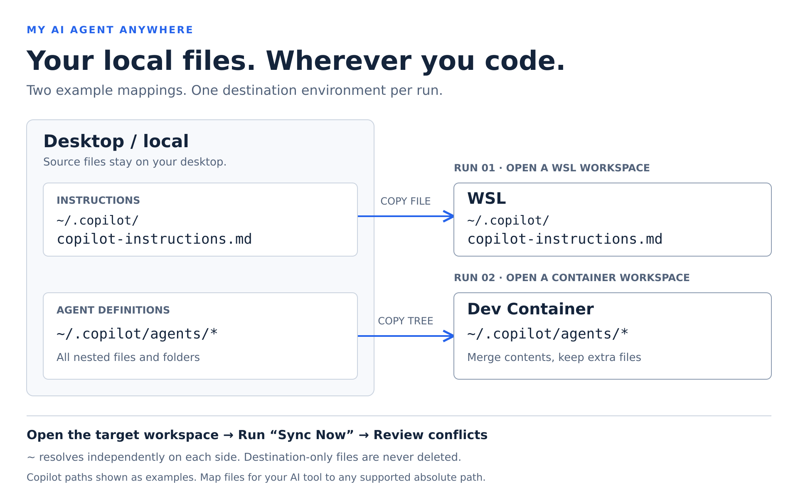

# My AI Agent Anywhere

[English](https://github.com/A29b/vsix-my-ai-agent-anywhere/blob/main/docs/store/README.md) | [日本語](https://github.com/A29b/vsix-my-ai-agent-anywhere/blob/main/docs/store/lang/ja/README.md) | 简体中文

将本地 AI 配置文件同步到 WSL 和开发容器。



图中路径以 Copilot 为例；请根据所用 AI 工具配置映射。每个箭头都表示在相应编辑器环境中单独执行一次
**Sync Now**，并非同时分发。`agents/*` 表示目录内容；配置时应填写目录路径 `agents`，而不是通配符。

手动将桌面版 VS Code 上的个人 AI 指令、智能体定义、技能及其他文件复制到当前的**本地、WSL 或开发容器**环境。
以桌面文件为源，无需为每个项目配置绑定挂载。

配置一次后，在要使用的编辑器窗口中运行 **My AI Agent Anywhere: Sync Now**。
扩展通过逐文件冲突检测保护目标端的修改，且不会删除仅存在于目标端的文件。

本扩展不是 GitHub 或 Microsoft 的官方产品。文档提供英语、日语和简体中文版本；命令和消息目前为英语。

## 适用人群

适合在桌面管理个人指令、智能体或技能，并希望将所选文件带入当前编辑环境的开发者，
而无需向每个项目添加个人文件或挂载配置。

- 使用桌面现有文件，包括 `.copilot` 之外的文件，无需将其上传到共享仓库。
- 一次配置精确目标路径，可按环境筛选。
- 合并目录时不删除仅存在于目标端的内容，并可检查目标端的修改，避免盲目覆盖。

如果 VS Code 已能在您的工作流程中提供所有自定义内容，或现有挂载、dotfiles 方案已满足需求，
您可能不需要此扩展。本扩展不能替代 Settings Sync，不管理 AI 服务账户，也不运行 AI 智能体。
请选择 AI 工具能够识别的目标路径；复制文件不保证工具会发现或使用这些文件。

## 从 Marketplace 安装

1. 在桌面版 VS Code 中打开**扩展**（`Ctrl+Shift+X`）。
2. 搜索 **My AI Agent Anywhere**，打开页面并选择**安装**。
3. 即使使用 WSL 或开发容器，也应将扩展安装在**桌面／本地端**：它从桌面读取文件，
   并通过当前编辑器连接写入目标环境。

请使用桌面版 VS Code 1.100 或更高版本，并打开受信任的文件夹。
远程环境需通过 WSL 或 Dev Containers 扩展连接。

### 首次同步

1. 运行 **My AI Agent Anywhere: Open Sync Configuration**。
2. 编辑下方映射并**保存** JSON。
3. 打开目标本地、WSL 或开发容器中的文件夹。
4. 运行 **My AI Agent Anywhere: Sync Now**。对于远程 `~/` 路径，请批准主目录解析任务；
   也可以取消并改用绝对目标路径。
5. 确认检测到的环境、解析出的主目录和比较数量。在**输出**中的
   **My AI Agent Anywhere** 查看准确的源路径和目标路径。
6. 确认批量操作，并逐一处理或跳过文件冲突。
7. 在 AI 工具中新建会话，检查配置是否被发现和应用。
   复制及字节一致性验证成功，并不证明工具已加载或应用配置。

不支持独立 Agents 窗口会话、SSH 及未知远程类型；不会将未知环境默认为本地工作区。

## 跨多个项目使用

**一份个人配置可以用于多个项目。** 在本地 VS Code、WSL 或开发容器中打开项目，
运行 **My AI Agent Anywhere: Sync Now**。源路径始终指向桌面端；目标路径指向当前编辑器窗口的环境。
无需逐一注册项目，也无需在项目仓库中添加配置文件。

| 项目打开位置 | 操作                                                |
| ------------ | --------------------------------------------------- |
| 本地         | 复制到本地目标；源和目标相同时跳过。                |
| WSL          | 复制到当前 WSL 环境；目标 `~/` 指执行用户的主目录。 |
| 开发容器     | 复制到当前容器；目标 `~/` 指执行用户的主目录。      |

使用**相同 WSL 主目录和目标文件**的项目共享同一文件及同步历史。
不同容器、连接或目标路径的历史相互独立。环境筛选决定哪些映射生效；
每次只复制到当前环境，不会一次同步所有项目。配置属于个人，并非按项目选择。

重建容器可能改变连接标识。如果无法访问之前的历史记录，已有且内容不同的目标文件会被视为冲突，
不会自动覆盖。仅打开项目不会触发同步；请在需要时运行命令。

## 配置

个人 `sync.json` 位于桌面端扩展存储中，不在项目内。
配置命令创建的示例只包含下方第一个映射。以下示例使用 GitHub Copilot 路径，
但扩展不限于 Copilot。请根据 AI 工具设置源和目标，并按需添加已存在的智能体或技能目录：

```json
{
  "version": 1,
  "mappings": [
    {
      "source": "~/.copilot/copilot-instructions.md",
      "destination": {
        "path": "~/.copilot/copilot-instructions.md"
      }
    },
    {
      "source": "~/.copilot/agents",
      "destination": {
        "path": "~/.copilot/agents"
      }
    },
    {
      "source": "~/my-container-skills",
      "destination": {
        "path": "~/.copilot/skills",
        "environments": ["devcontainer"]
      }
    }
  ]
}
```

| 字段                       | 含义                                                                              |
| -------------------------- | --------------------------------------------------------------------------------- |
| `version`                  | 必填；当前为 `1`。                                                                |
| `mappings`                 | 文件或目录映射组成的非空数组。                                                    |
| `source`                   | 桌面文件系统路径，与当前打开的环境无关。                                          |
| `destination.path`         | 当前编辑器环境中的精确目标路径。                                                  |
| `destination.environments` | 可选的非空数组，可包含 `local`、`wsl`、`devcontainer`；省略时适用于全部三个环境。 |

筛选器只选择映射，不会建立连接或在一次操作中复制到多个环境。被排除的源不会扫描。
不同环境可以使用独立、互不重叠的筛选映射。未知字段或值以及重复的环境筛选均会报错。

### 路径和主目录

- 源路径 `~/` 指**桌面用户的主目录**（例如 `C:/Users/me`）。
- 目标路径 `~/` 指**当前环境执行用户的主目录**。本地工作区使用桌面主目录。
- 不会猜测远程主目录。获得批准后，在远程工作区运行固定的 `/bin/sh` 任务，
  将 `$HOME` 写入远程 `/tmp` 下唯一命名的私有目录，通过 VS Code 读取后删除该目录。
  配置路径和文件内容不会作为命令执行。
- 此操作需要远程任务执行能力、`/bin/sh`、`mkdir` 和可写的 `/tmp`。
  使用任务环境中的 `HOME`；自定义任务环境可能改变其值，请检查显示的结果。
  该任务不会检查 AI 工具进程的主目录。探测失败时停止同步；使用绝对目标路径则不需要探测。
- 支持桌面绝对路径（包括 Windows 盘符和 UNC）以及目标操作系统格式的绝对目标路径。
  建议使用 `~/` 和 `/` 分隔符；JSON 中的反斜杠必须转义。
- 不支持 `~user`、`~\`、环境变量插值、相对路径和 `..` 路径遍历。
  不会自动附加 `.copilot` 或源文件名。

### 文件和目录合并

文件映射指定精确的目标文件名，因此可以重命名。
目录映射会逐文件递归合并**目录内容**。例如，`~/skills` → `~/.copilot/skills`
会将 `review/SKILL.md` 放到 `~/.copilot/skills/review/SKILL.md`，而不是 `skills/skills/review/SKILL.md`。

缺失的目标目录和父目录会被创建，包括空的源目录。不会整体替换目录。
**仅存在于目标端的文件和目录绝不会被删除**，即使对应源内容后来被删除。
文件／目录类型不匹配时，预检会停止批量操作，不会删除造成冲突的路径。

在本地工作区中，解析后路径相同的源和目标（以及具有相同 inode 的文件，如硬链接）会跳过。
递归自复制、跨映射的源／目标重叠以及目标根目录重叠均会被拒绝。
其他本地硬链接目标文件也会被拒绝，以保护其别名。不支持所选源或目标路径中的符号链接。

不要选择整个主目录或整个 `.copilot` 目录：其中可能包含凭据和会话。
避免重复复制 VS Code 已提供的智能体或技能。

## 冲突与覆盖保护

逐文件比较源、目标和上次共同的 SHA-256 基准。基准按环境、解析后的源路径和完整目标 URI
（包括远程连接标识）隔离。

| 状态                       | 行为                     |
| -------------------------- | ------------------------ |
| 两端字节相同               | 跳过写入并记录共同基准。 |
| 目标和基准都不存在         | 新建。                   |
| 只有源发生变化             | 批量确认后更新。         |
| 目标自基准以来被修改或删除 | 冲突。                   |
| 已有不同的目标且无基准     | 冲突。                   |

**Show diff** 比较只读快照：左侧是桌面端，右侧是目标端。
**Skip this file** 保留目标，冲突仍未解决。
**Force overwrite with desktop version** 需要再次确认，使用所检查的源快照，不包含后续修改。
**Stop sync** 不会撤销之前已复制的文件或创建的目录。
手动解决时，请将所需修改合并到桌面源文件；两端字节相同后，下次同步会记录共同基准。

**扩展不会创建备份，也无法恢复被覆盖的内容。** 批量确认和强制覆盖确认都会明确警告。
如果需要恢复目标内容，请事先自行备份。写入前会重新检查，写入后会读取并验证字节。
写入或验证失败时不会记录成功，但也不会恢复先前内容。

## 限制与故障排除

- **找不到命令：** 在桌面版 VS Code 安装扩展并重新加载。
- **环境不受支持：** 在编辑器中打开受支持环境的文件夹，不要仅使用 Agents 窗口会话。
- **主目录探测失败：** 检查远程任务、`/bin/sh` 和 `/tmp` 权限，或使用绝对目标路径。
  清理失败会在输出中报告。
- **权限不足：** 检查源／目标用户和权限。扩展不会使用 `sudo` 或修改所有权。
- **类型不匹配或符号链接：** 选择普通文件／目录并手动消除歧义；扩展不会删除冲突对象。
- 每次运行在所选映射范围内的上限：**每文件 5 MiB、1,000 个文件、源内容总计 50 MiB、
  扫描 10,000 个条目**（包括目录）。用于比较的目标快照另有**总计 50 MiB** 的限制。
- 不复制脚本可执行权限。可能需要另行配置运行环境、换行符和执行权限。差异视图面向文本。
- VS Code 文件系统 API 不提供原子的比较并交换操作；同步期间请避免并发修改目标或文件系统。
- 不提供整个批次的事务、回滚、自动删除或文件监视。

## 下一阶段

**计划中，尚未实现：** 在本地、WSL 和开发容器的编辑器工作区打开时，可选择启用自动同步。

- 无需每次确认即可复制新文件及仅源端发生的更改；不写入未更改的文件，也不自动覆盖冲突。
- 通知冲突，并引导用户通过手动 **Sync Now** 检查。
- 等待目标文件系统可访问，并针对连接就绪进行有界重试。权限和配置错误会停止运行。
- 启用自动化时获取明确同意，包括远程主目录解析任务和不带备份的覆盖。
- 成功时保持安静，可在 **My AI Agent Anywhere** 输出中查看结果。

目标可访问不代表所有开发容器生命周期命令都已完成；与容器初始化的时序仍需验证。
同步也无法保证已启动的 AI 会话重新加载配置。同步完成后请启动新会话。
这些是路线图方向，并非发布日期承诺。

## 隐私

My AI Agent Anywhere 读取选定的桌面文件，写入当前环境，并在桌面保存配置和哈希。
不会向额外的云服务发送文件，也不会添加遥测。远程传输使用 VS Code 的现有连接，可能产生网络流量。
它不会改变 AI 工具自身的数据处理方式。

## 其他信息

### 配置和历史记录存储

使用 **My AI Agent Anywhere: Open Sync Configuration** 编辑设置，无需手动查找存储目录。

配置是 VS Code 桌面端扩展存储（`globalStorageUri`）中的 `sync.json`。
基准哈希保存在 VS Code `globalState` 中，按环境、绝对源路径和完整目标 URI 区分。
扩展不会在项目文件夹中创建同步元数据，也不会保存备份。配置和历史不会自动在不同桌面安装之间共享。

### 可选：从 VSIX 安装

如果已获得 VSIX，在桌面版 VS Code 中运行 **Extensions: Install from VSIX...**，
选择文件并在需要时重新加载。双击文件不是安装方法。

### 语言

使用顶部链接切换英语、日语和简体中文文档；VS Code 不会根据显示语言自动选择 README。
